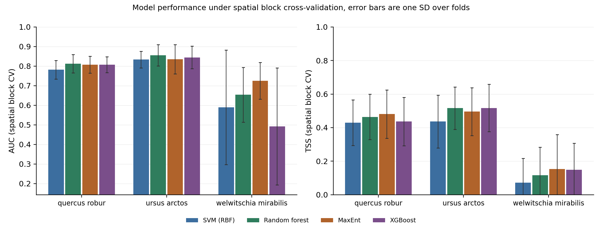
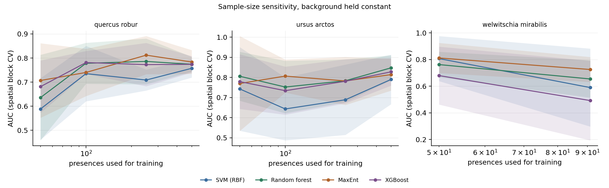

# Species distribution models, four algorithms compared

MaxEnt, random forest, an RBF support vector machine and XGBoost, trained on the
same GBIF records, the same background sample and the same folds, then scored on
the same metrics. The question is not which model wins in general, it is which
model wins in a given data situation, and how much of a reported win is an
artefact of the validation scheme.

**Short answer, from this panel:** maximum entropy is the safest choice when
presences are scarce (3 of 4 models fail on the 91-record case while MaxEnt holds
0.725 AUC), the tree ensembles take over once there are a thousand or more
records, and the RBF machine is the most expensive per unit of accuracy and the
first to fail at small sample sizes. Every model loses 0.10 to 0.17 AUC when
random folds are replaced by spatial blocks, most of all XGBoost.



## The comparison

Spatial block cross-validation, five folds, 2 000 background cells shared by all
models. AUC is rank based, TSS uses a threshold fitted on a held-out 30 percent
calibration split inside each training fold.

| Species | Presences | SVM (RBF) | Random forest | MaxEnt | XGBoost |
|---|---|---|---|---|---|
| Quercus robur | 1 835 | 0.782 / 0.430 | **0.813** / 0.464 | 0.808 / **0.480** | 0.807 / 0.437 |
| Ursus arctos | 1 418 | 0.833 / 0.436 | **0.856** / 0.516 | 0.835 / 0.495 | 0.844 / **0.517** |
| Welwitschia mirabilis | 91 | 0.590 / 0.072 | 0.654 / 0.116 | **0.725** / **0.152** | 0.492 / 0.149 |

Cells read as AUC / TSS. Bold marks the best value in the row.

Under stratified random folds the same models score 0.86 to 0.92 AUC, and the
ordering changes. That gap is the first result of the study:

| Model | Mean AUC, random folds | Mean AUC, spatial blocks | Inflation |
|---|---|---|---|
| MaxEnt | 0.890 | 0.789 | +0.101 |
| Random forest | 0.885 | 0.774 | +0.111 |
| SVM (RBF) | 0.865 | 0.735 | +0.131 |
| XGBoost | 0.883 | 0.715 | +0.168 |

The flexible learners gain most from neighbouring records landing in different
folds. A study that reports only random-fold AUC will rank XGBoost above MaxEnt;
with spatial blocks the order reverses.

## The three cases

| Case | Extent | GBIF records | After QC | Grid cells | Modelled | Regime |
|---|---|---|---|---|---|---|
| Quercus robur | Europe, 62 by 37 degrees | 9 000 pulled (1.7 M available) | 5 543 | 1 836 | 1 835 | high effort, broad niche |
| Ursus arctos | same extent | 9 000 pulled (52 800) | 3 569 | 1 418 | 1 418 | moderate effort, fragmented |
| Welwitschia mirabilis | Namib, 8 by 14 degrees | 974 (all) | 668 | 92 | 91 | low effort, narrow endemic |

Two species share an extent so their background pool is identical and the
difference between them is the presences alone.

## Method

**Records.** GBIF occurrence search with coordinates, no geospatial issue flag,
and `occurrenceStatus=PRESENT`. Pages are fetched in parallel and capped at
9 000 records, because the search API stalls beyond roughly 10 000 offsets. The
cap is recorded in `results/provenance.json`.

**Quality gates.** Applied in order, with the count removed by each recorded in
`results/quality_gates.csv`:

| Gate | Rule | Quercus robur retention |
|---|---|---|
| coordinate_valid | in range, not the null island pair | 100.0 % |
| inside_study_extent | inside the calibration box | 94.3 % |
| no_fatal_gbif_issue | no zero, swapped, negated, out-of-range or country-mismatched coordinate | 100.0 % |
| basis_of_record_accepted | specimen, observation, machine observation | 100.0 % |
| year_recent | 1950 or later | 100.0 % |
| coordinate_uncertainty | stated value at most 10 km, missing values retained | 99.8 % |
| duplicate_coordinates | one record per coordinate pair | 65.4 % |

A missing uncertainty field is an absent measurement, not a poor one, so those
records are kept and the count is disclosed. Dropping them would delete almost
every herbarium record of a narrow endemic. A strict profile is available with
`--require-uncertainty`.

**Thinning.** One record per 10 arc minute cell, best located first. This is why
9 000 pulled records become 1 836 cells for the oak.

**Climate.** WorldClim 2.1 bioclim at 10 arc minutes plus elevation, 20 layers,
clipped to each extent. Variables correlated above |r| = 0.8 are pruned once per
extent and the surviving ten are shared by all four models. For Europe the set is
BIO02, BIO03, BIO04, BIO06, BIO08, BIO10, BIO13, BIO14, BIO15 and elevation.

**Background.** 2 000 cells drawn once per species from the eligible cells of the
extent and given to every model, including MaxEnt, which normally samples its own.
That removes a confound at the cost of handicapping MaxEnt slightly.

**Models.** Fixed hyperparameters, chosen a priori and never tuned against the
evaluation folds: MaxEnt with auto features and beta 1 through the reference
Java jar; random forest with 500 trees, `min_samples_leaf=2` and balanced class
weights; RBF SVM with C 10 on standardised predictors; XGBoost with 400 rounds at
depth 4 and learning rate 0.05.

**Evaluation.** Two schemes over the same folds: stratified random 5-fold, and
spatial block 5-fold using a 5 by 5 grid over the extent with `GroupKFold`. AUC
for ranking, TSS at a threshold taken from a held-out calibration split so it is
never tuned on the data the model was fitted to, plus the share of eligible cells
predicted suitable at that threshold.

## What the comparison shows

**With enough presences, the choice barely matters.** On the oak, 1 835 presences
and ten predictors, the four models span 0.031 AUC and 0.05 TSS. Any of them
would support the same sentence about the species' climatic niche. MaxEnt gets
the best TSS and random forest the best AUC, which is noise at this sample size,
not a ranking.

**With few presences, it matters a lot.** On 91 records the spread is 0.233 AUC.
MaxEnt holds 0.725; XGBoost falls to 0.492, which is chance. A boosted ensemble
with 400 rounds has more parameters than that dataset can support, and the
four-fold result (one block lacked enough presences to score) carries a standard
deviation of 0.299. Reporting a single number for XGBoost here would be
dishonest; the honest statement is that it did not converge on a usable model.

**The RBF machine degrades in a specific way.** At 91 presences it predicted the
entire extent suitable (area fraction 1.000), so its TSS of 0.072 comes from
calling everything present. Its AUC gain from 50 to 1 835 training presences is
the steepest in the panel (+0.169), which fits the model: a kernel machine needs
points to define a boundary, and until it has them it does not find one.

**The learning curves say where each model turns on.** MaxEnt is already at 0.707
AUC with 50 oak presences and reaches 0.784 at full sample, while random forest
climbs from 0.636 to 0.774. Below roughly 100 presences the ranking favours
MaxEnt on both species where that range is measurable.



## Which algorithm fits which data situation

| Situation | Start with | Why, from this panel |
|---|---|---|
| Under about 100 usable presences | MaxEnt | 0.725 against 0.492 to 0.654 for the alternatives; it is the only model that stays coherent at that sample size |
| 100 to 500 presences | MaxEnt, then random forest | the curves cross near 100; both are defensible, random forest has lower variance across folds once it has data |
| Several thousand presences, wide range | Random forest or MaxEnt | 0.813 against 0.808 on the oak, TSS 0.480 for MaxEnt; pick on what you need downstream, not on AUC |
| Clustered, fragmented records | Random forest | 0.856 on the bear, the best in the panel; the model tolerates the gaps between populations |
| Many correlated predictors | Tree ensembles | invariant to monotone rescaling; the SVM is the most sensitive to the correlation that pruning leaves behind |
| A probability for policy or reporting | MaxEnt | cloglog output on a 0 to 1 scale; tree vote fractions are not probabilities |
| Prediction into a novel climate | MaxEnt | clamping limits extrapolation; trees fall back to the nearest observed leaf and cannot extrapolate at all |
| Many species, tight compute budget | Random forest | 6 to 21 s per species here against 35 to 73 s for MaxEnt |
| Fastest raw fit, large data | XGBoost | 4.6 to 8.1 s, but it needs the presences to justify its capacity |

Two cautions that follow from the numbers rather than the literature. First,
random-fold AUC overstates every model by 0.10 to 0.17, so comparisons built on
it are comparisons of interpolation ability. Second, an AUC of 0.49 is not a
model that is "slightly worse"; it is a model with no signal, and it should be
reported as a failure rather than averaged into a mean.

## Limitations

- **10 arc minute resolution sets a floor on what can be modelled.** A candidate
  narrow endemic, *Nepenthes rajah*, has 80 GBIF records, 71 of them recent, all
  at a stated 31 km precision. After thinning only two grid cells remain, so no
  model was fitted. The species was replaced by *Welwitschia mirabilis*, which
  has 974 records and a median stated uncertainty of 8 m.
- **9 000 records is a cap, not the population.** The oak has 1.7 M records.
  Cell thinning makes the cap tolerable, but it is not a random sample of the
  index, and the ordering of the search API is not random either.
- **One background size, no bias correction.** Real sampling effort is uneven,
  and no target-group background or bias file is used here.
- **Hyperparameters are fixed a priori.** Tuning per fold would leak into the
  comparison, so the table measures each algorithm's default behaviour, not its
  best behaviour.
- **The small-N case is four folds, not five.** One spatial block held too few
  presences, which is why the standard deviations there are wide.
- **AUC is comparable within a species, never across species**, because the
  extent and the background differ.
- **Predicted area is descriptive.** It depends on the threshold and the extent,
  and it is not an accuracy measure.
- **No Boyce index, no partial dependence, no calibration curves.** The panel
  answers the discrimination question only.

## Reproducing

The `geo` conda environment carries the stack, and MaxEnt needs Java plus the
reference jar:

```bash
mkdir -p vendor && curl -sL -o vendor/maxent.jar \
  https://raw.githubusercontent.com/mrmaxent/Maxent/master/ArchivedReleases/3.4.4/maxent.jar

~/miniconda3/envs/geo/bin/python scripts/run_sdm.py --species all
```

A single case, faster:

```bash
~/miniconda3/envs/geo/bin/python scripts/run_sdm.py \
  --species welwitschia-mirabilis --fast
```

MaxEnt builds a Swing window even in batch mode, so a machine with no X display
needs one. The pipeline prefixes the Java call with `xvfb-run -a` when `DISPLAY`
is unset and `xvfb` is installed; on Debian and on Colab that is
`apt-get install -y xvfb`.

On a Colab VM, which uploads the project, installs what is missing, runs, and
pulls the results back:

```bash
bash colab/run_on_colab.sh
SDM_ARGS="--species welwitschia-mirabilis --fast" bash colab/run_on_colab.sh
```

MaxEnt opens a Swing window even in batch mode, and the Colab kernel has no
display that survives it, so MaxEnt rows come back empty there while random
forest, SVM and XGBoost run normally. A fold that cannot be fitted is skipped
and reported with `n_folds = 0` rather than aborting the species. For a remote
run, select the models that do not need Java:

```bash
SDM_ARGS="--models rf,svm,xgboost" bash colab/run_on_colab.sh
```

The run takes about fourteen minutes for the three cases on a laptop, MaxEnt
dominating the wall clock. Every table in this README is generated by the run;
`results/provenance.json` records the seed, the caps, package versions and the
GBIF counts at query time.

## Files

```
src/sdm/
  config.py        species panel, paths, quality rules
  occurrences.py   GBIF retrieval, seven quality gates, cell thinning
  environment.py   WorldClim download, clipping, collinearity pruning, sampling
  models.py        MaxEnt subprocess driver and the three scikit-learn models
  evaluation.py    spatial blocks, AUC, calibrated TSS
  pipeline.py      orchestration, incremental table writes, provenance
  report.py        figures and the evidence table
scripts/run_sdm.py CLI entry point
colab/             Colab VM bootstrap and runner
results/
  comparison_table.csv     the table above, all schemes
  fold_metrics.csv         per-fold detail, the spread behind every mean
  learning_curve.csv       AUC against training sample size
  quality_gates.csv        retention per gate per species
  record_retention.csv     end to end record accounting
  collinearity_pruning.csv which variable was dropped against which
  algorithm_fit.csv        evidence table behind the discussion
  provenance.json          seed, caps, versions, GBIF counts
  figures/                 metrics and learning curves
```

## References

- Phillips, Anderson and Schapire 2006. Maximum entropy modeling of species
  geographic distributions. *Ecological Modelling* 190:231-259.
- Elith et al. 2011. A statistical explanation of MaxEnt for ecologists.
  *Diversity and Distributions* 17:43-57.
- Valavi et al. 2022. Predictive performance of presence-only species
  distribution models. *Ecological Monographs* 92:e01486.
- Roberts et al. 2017. Cross-validation strategies for data with temporal,
  spatial, hierarchical or phylogenetic structure. *Ecography* 40:913-929.
- Zizka et al. 2019. CoordinateCleaner. *Methods in Ecology and Evolution*
  10:744-751.
- Zizka et al. 2020. Coordinate uncertainty thresholds in occurrence data.
  *Ecography* 43:1393-1403.
- Allouche, Tsoar and Kadmon 2006. Assessing the accuracy of species
  distribution models: prevalence, kappa and the true skill statistic. *Journal
  of Applied Ecology* 43:1223-1232.
- Fick and Hijmans 2017. WorldClim 2. *International Journal of Climatology*
  37:4302-4315.
